### Hi there 👋 I'm Duarte Junior

AI Engineer & Data Engineer. I build LLM agents, evaluation pipelines and data platforms, mostly in Python.

#### Stack

**AI / LLM**

**Data**

**Tooling**

#### Contact

#### Game of the day

<picture>
  <source media="(prefers-color-scheme: dark)" srcset="https://raw.githubusercontent.com/duartejr/duartejr/output/game-dark.svg">
  
</picture>
